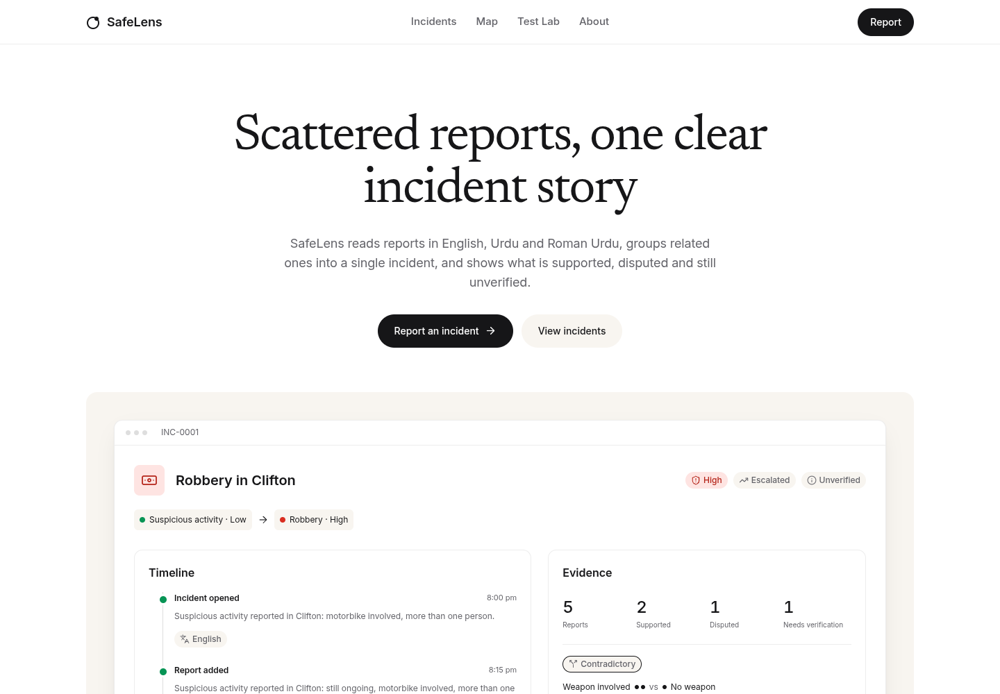

# SafeLens

SafeLens turns community reports in English, Urdu, Roman Urdu and mixed language into structured incidents with related reports, escalation and claim-level evidence. This academic prototype makes uncertainty visible and complements official emergency services.

## Local setup

1. Use Node 24 (Node 22 or newer) and pnpm 11.25.0.
2. Open the existing checkout. If needed, clone `https://github.com/sarahaiwork2026/safelens.git` and enter `safelens`.
3. Run `pnpm install --frozen-lockfile`.
4. Create `apps/web/.dev.vars` from `.dev.vars.example` if it does not already exist. Keep `ENVIRONMENT=development` and `EXTRACTOR_CHAIN=rules` for local tests. Preserve existing secrets.
5. Run `pnpm db:migrate`.
6. Run `pnpm dev` and open the address printed by Vite.
7. Submit a report or open Test Lab and run the 25 simulated reports. No API key is required.

The standard demo is in [TEST-DATA.md](docs/specs/TEST-DATA.md#7-demo-script-minimum-demonstration). Phased implementation and validated checkpoints are in [PROGRESS.md](docs/PROGRESS.md) and [PLAN.md](docs/PLAN.md).

## Commands

| Command | Purpose |
| --- | --- |
| `pnpm dev` | SPA, Worker API and persistent local D1 |
| `pnpm build` | Production SPA and Worker build |
| `pnpm preview` | Serve workerd with production-style text compression |
| `pnpm typecheck` | Strict TypeScript checks |
| `pnpm lint` | ESLint and copy/style rules |
| `pnpm test` | Core, component and real D1 Worker tests |
| `pnpm test:e2e` | Build, reset local D1, start preview and run browser tests |
| `pnpm perf` | Check bundle budgets and run mobile Lighthouse on the built app |
| `pnpm db:migrate` | Apply local migrations |
| `pnpm db:reset` | Delete local data and apply migrations |
| `pnpm snapshot` | Regenerate the landing incident from C01 fixtures |
| `pnpm eval:llm` | Score all 51 fixtures against a configured local AI Worker |
| `pnpm seed:demo --target <url>` | Submit non-Clifton context reports through the API |
| `pnpm db:migrate:remote` | Apply production migrations after configuring D1 |
| `pnpm deploy` | Check public configuration, build and deploy |
| `pnpm db:reset:remote` | Human-only, interactive production deletion |

`preview` forwards to the actual workerd build and adds gzip for text, matching Cloudflare edge delivery without changing API behavior or headers. Lighthouse measures that same preview.

`test:e2e` deliberately clears the local database. It creates a rules-mode `.dev.vars` only when absent and refuses incompatible existing flags. It never replaces existing credentials. Browser tests use a per-test local rate key and a fixture map style; the real map implementation and DOM markers still run. Live tile availability is a separate check.

Playwright uses installed Chromium at `/usr/bin/chromium` in this cloud environment. Elsewhere, set `PLAYWRIGHT_CHROMIUM_EXECUTABLE_PATH` to an installed Chromium executable or install the matching Playwright browser and configure its executable path. Lighthouse uses `CHROME_PATH`, defaulting to `/usr/bin/chromium`.

## Configuration

Keep secrets in the ignored `apps/web/.dev.vars` for local development, and Cloudflare Worker secrets in production. Never put credentials in a `VITE_` variable, tracked file, browser bundle or chat.

| Name | Purpose |
| --- | --- |
| `GROQ_API_KEY` | Optional local AI, required for the live Groq demonstration |
| `GEMINI_API_KEY` | Optional secondary provider |
| `DRAFT_SECRET` | Production signing key, at least 32 random bytes |
| `IP_HASH_SALT` | Production rate-key salt, at least 32 random bytes |
| `TURNSTILE_SECRET_KEY` | Production browser verification |
| `ENVIRONMENT` | `development` locally, `production` on Cloudflare |
| `EXTRACTOR_CHAIN` | `rules` for tests; `groq,gemini,rules` for AI mode |
| `GROQ_MODEL` | Defaults to `openai/gpt-oss-120b` |
| `GEMINI_MODEL` | Optional model, confirm current availability before use |
| `LLM_DAILY_BUDGET` | Default 800 calls per provider, repair calls count too |
| `NOMINATIM_USER_AGENT` | Identifying application string with the human's contact email |
| `VITE_TURNSTILE_SITE_KEY` | Public build-time widget key, never a secret |
| `SAFELENS_TARGET` | Optional target for manual AI evaluation |

Development without a signing secret uses an ephemeral key initialized during a request. Restarting that Worker invalidates unfinished drafts. Production refuses report submissions when signing, IP salt or Turnstile secrets are missing. Rules mode works without AI keys; provider failures, exhausted budgets and invalid output fall back to rules. To test AI locally, configure a key and change the chain in `.dev.vars`; restore `rules` before automated tests.

Known areas resolve locally. Unknown landmarks ask for an area when no identifying Nominatim contact is configured. `scripts/verify-gazetteer.ts` checks unlocked coordinates with that contact and respects the service rate limit. Do not change locked fixture coordinates.

## Test Lab and evidence

Test Lab sends each of the 25 reports to its own `test:<runId>` dataset. Live incidents remain separate. It compares actual report fields and final threads, displays differences and computes seven coverage checks from actual results. A run can be resumed in the same browser session; reset deletes only that run. Runs older than an hour are cleaned up when another run starts.

Supported means at least two reports repeat a claim. Contradictory means reports contain opposing claims. Unconfirmed means one report mentions a claim. These labels never establish that a report is true. Status controls are intentionally public, origin checked, rate limited and recorded in the timeline.

The base fixture contract stores 23 reports, holds 2 for missing location, forms 12 threads and records 3 escalation events. The additional 26 cases cover Urdu negation, time across midnight, prompt injection, redaction, incomplete input and location masking. The landing is a generated static snapshot, never a live incident or a fabricated metric.

## Production preparation

Local development is complete independently of production accounts. Deployment and live AI scores are not implied by local test results.

1. Create a free Cloudflare account and authenticate with `pnpm --filter web exec wrangler login`.
2. Create D1 using `pnpm --filter web exec wrangler d1 create safelens`. Replace the local-only database ID in `apps/web/wrangler.jsonc` with the returned ID.
3. Apply `pnpm db:migrate:remote`.
4. Create a managed Turnstile widget for the real hostname and set its public key as `VITE_TURNSTILE_SITE_KEY` before building.
5. Set `GROQ_API_KEY`, `DRAFT_SECRET`, `IP_HASH_SALT` and `TURNSTILE_SECRET_KEY` with `pnpm --filter web exec wrangler secret put <NAME>`. Gemini is optional. Generate signing and salt values securely; never paste them into chat.
6. Add the identifying contact to `NOMINATIM_USER_AGENT` in Wrangler vars, verify unlocked gazetteer coordinates and recheck emergency contacts and free limits.
7. Run `pnpm deploy`, then the live smoke tests and demo from the plan, with Groq and again with the key removed.

The deploy command rejects the local-only D1 ID, absent or test Turnstile site keys and a missing Nominatim contact. It does not create accounts or secrets. `seed:demo` keeps Clifton free for the scripted demo and respects report limits. Production Turnstile remains enforced: use a private `--tokens-file <path>` containing one fresh single-use token per report, or submit the context reports through the browser. Tokens are never logged. A CLI cannot mint valid browser-verification tokens.

In this cloud environment, live OpenFreeMap access needs `tiles.openfreemap.org` allowed in environment settings. The domain addition is saved as a configuration draft. Provider/geocoder access will additionally need `api.groq.com`, optionally `generativelanguage.googleapis.com`, and `nominatim.openstreetmap.org` when those features are enabled. Production Turnstile uses `challenges.cloudflare.com`.

## Free services and credits

The approved stack uses free tiers, with no paid service required for local development:

- [Cloudflare Workers, D1 and Turnstile](https://www.cloudflare.com/developer-platform/)
- [Groq](https://groq.com/) and optional [Google Gemini](https://ai.google.dev/)
- [OpenFreeMap](https://openfreemap.org/), [MapLibre](https://maplibre.org/) and [OpenStreetMap](https://www.openstreetmap.org/copyright)
- [Nominatim](https://operations.osmfoundation.org/policies/nominatim/), cached fallback only
- [GitHub Actions](https://github.com/features/actions)
- Self-hosted Newsreader and Inter through [Fontsource](https://fontsource.org/)

The incident.io screenshots are visual references only. SafeLens uses its own wordmark, copy and implementation.

## Limits and validation status

The prototype uses simulated reports. AI may misunderstand unclear or mixed-language text; location depends on user input, and external services require connectivity. Alerts are basic in-app alerts with unverified information, not emergency notifications. SafeLens complements official emergency services and does not replace them.

Live Groq scores, extra AI evaluation, unlocked-coordinate verification, emergency-contact rechecking, real tile timing and production deployment remain external checks. `eval:llm` records base scores plus extra-case comparisons in isolated datasets and fails if provider fallback replaces the live AI check. See PROGRESS.md for executed checks and current blockers.

Production dependency audit found zero vulnerabilities. The approved Cloudflare Worker test package is deprecated upstream; its embedded runtime uses the documented test compatibility-date override. The application's production configuration uses its creation date. No alternative test dependency was introduced without approval.

## Rendering and performance

The production build renders the landing, report and incident-list entry HTML from the same React routes used by the SPA. Hydration then enables controls and loads live data. No build-time incident counts are injected. The report form stays disabled until its event handlers are ready. Initial CSS is included in the HTML, and hashed external assets remain cacheable; the bundle check counts both CSS deliveries. Map rendering stays lazy.

Lighthouse uses a 390 px mobile viewport, simulated Fast 4G at 9 Mbps and 60 ms RTT, and 4x CPU slowdown. Those network parameters follow Chromium's [Fast4GConditions](https://github.com/ChromeDevTools/devtools-frontend/blob/main/front_end/core/sdk/NetworkManager.ts), matching the architecture's Fast 4G target. Lighthouse's default 1.6 Mbps, 150 ms profile is Slow 4G; the earlier stress run on that profile had 2.48 to 2.73 second LCP. Assertions remain performance 90+, accessibility 100, best practices 100 and LCP below 2 seconds.

## Local validation and preview

Final local run: 47 core/frontend tests, 25 Worker tests and 28 browser tests passed. Typecheck, lint, the production build and dependency audit passed. The minimum demonstration works through reporting, multilingual grouping, escalation, responder review, map selection, signed follow-up and the complete Test Lab.

| Route | Performance | Accessibility | Best practices | Fast 4G LCP |
| --- | --- | --- | --- | --- |
| Landing | 100 | 100 | 100 | 777 ms |
| Report | 99 | 100 | 100 | 930 ms |
| Incidents | 97 | 100 | 100 | 763 ms |

These are local production-build measurements, not hosted production results. The machine-readable record is [performance-results.json](docs/performance-results.json). Hosted CI and live external-service checks remain pending.

Actual app captures: [overview](docs/preview/overview.png), [report](docs/preview/report-desktop.png), [mobile](docs/preview/report-mobile.png), [incidents](docs/preview/incidents-desktop.png), [full landing](docs/preview/landing-desktop.png) and [dark landing](docs/preview/landing-dark.png).

## Review checkpoint, 18 October 2026

The user requested review before any GitHub push or production deployment. Neither has been performed. Cloudflare account-token authentication and Groq authentication passed. Three direct live Groq adapter checks returned valid English, Urdu and Roman Urdu extractions; the fourth request reached the free-tier cooldown. This is not the full AI evaluation.

The local Worker cannot resolve api.groq.com in this managed environment, so its provider chain falls back to rules. A full AI evaluation was attempted but did not complete: outbound DNS failed and concurrent local Worker processes caused a SQLite lock. Keep one Worker process per local D1 persistence directory. Full live-provider scores remain pending.

A temporary Cloudflare Tunnel was attempted for review without deployment. The tunnel endpoint returned HTTP 403, and cloudflared also encountered the managed DNS restriction. No working public preview URL was obtained. The app runs locally on port 4173; this environment does not expose that loopback address as a user-facing preview.

Review artifacts: [recorded working demo](docs/preview/safelens-demo.webm), [structured report](docs/preview/report-result.png), [Test Lab 25/25](docs/preview/test-lab.png). Live browser map rendering currently uses the failure fallback under this environment's network restrictions; marker/filter interactions pass against a fixture map style.
